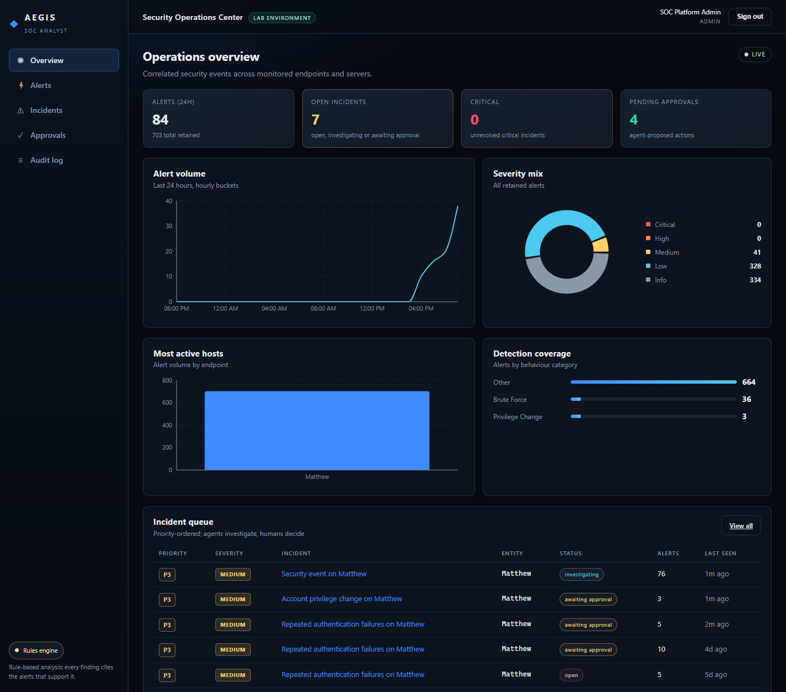
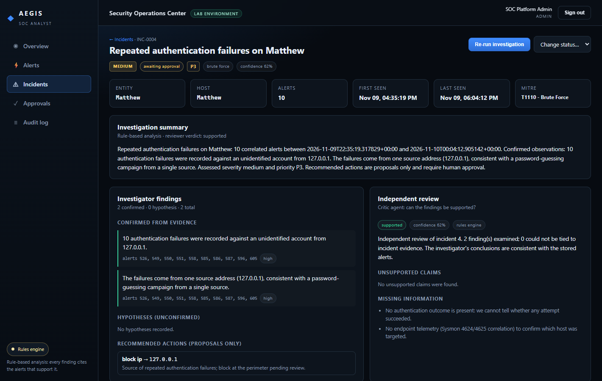
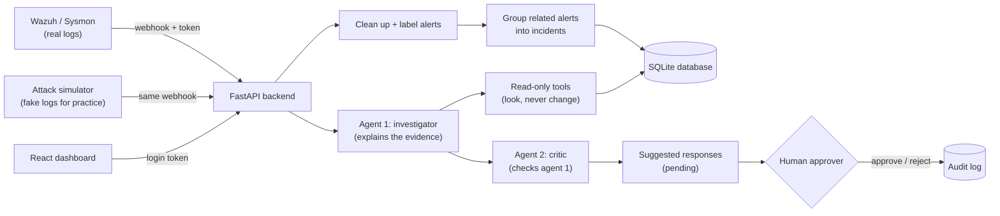

# Aegis SOC

A small security-operations dashboard I built to learn how a real SOC works — and to see whether an
AI assistant can actually help an analyst without ever being allowed to do anything on its own.

I'm early in my cybersecurity career. Most of what I read about "AI in security" was either a vendor
slide deck or a chatbot demo, so I wanted something I could run on my own laptop: point some logs at
it, watch alerts turn into incidents, have two agents read the evidence, and then decide myself
whether to act. That's the whole idea. The AI explains and suggests. A human clicks.

This is a learning project, not a product. Below I've listed what genuinely works and what doesn't,
because the honest list is the part I'd want to read if I were looking at someone else's repo.

---

## What it does, in plain English

Think about someone on the night shift at a company, watching for break-ins on the network. Their
screen fills up with alerts all night. Most are noise; a few matter. The hard part isn't spotting a
single weird login — it's turning a pile of small events into "something is happening on this machine,
here's what I think it is, here's what I'd do about it."

This app does that loop:

1. **Security logs arrive.** A SIEM (in my case Wazuh) sends each event to this app. One event might
   be "someone failed to log in to `WKS-ENG-04` as `j.smith` from `203.0.113.45`".
2. **The app tidies them up.** Timestamps, hostnames, IP addresses and usernames get normalised, junk
   and control characters get stripped, and duplicates get dropped, so the same event sent twice
   doesn't become two alerts.
3. **It guesses what each alert means.** A set of plain regex rules sorts each alert into a category
   (failed logins, PowerShell abuse, network beaconing, privilege changes, file tampering), gives it a
   severity, and tags it with a MITRE ATT&CK technique. This is rules, not machine learning — I'd
   rather have something I can read and explain than a black box I can't.
4. **Related alerts become one incident.** Eight failed logons from the same address against the same
   host in a short window is not eight things to look at; it's one brute-force attempt. Grouping them
   is what makes the queue human-sized.
5. **Two AI agents read the file.** The *investigator* writes up what happened, in sentences, citing
   the exact alert IDs it used. The *critic* then checks that write-up independently and can disagree
   with it. Both agents get six read-only tools — they can look things up, never change anything.
6. **A human approves.** Any suggested response (block an IP, isolate a host, disable an account) sits
   in an approval queue until someone with the approver role decides. Analysts can propose actions but
   can't approve their own containment.
7. **Everything is written down.** Who did what, when, from which address, into an audit log.

One rule I cared about a lot: **the app never pretends a model wrote something it didn't.** If no
language model is reachable, it says so on screen and in every investigation record, and falls back to
a deterministic ("rules only") analysis that is labelled as such.

---

## Words you'll see in this README

I had to look most of these up myself, so here they are in one place.

| Term | What it means here |
| --- | --- |
| **SOC** | Security Operations Centre — the team/room where people watch for attacks. |
| **SIEM** | The tool that collects logs from lots of machines and makes them searchable. Wazuh is one. |
| **Wazuh** | Open-source SIEM. It watches servers and endpoints and forwards alerts. |
| **Sysmon** | A Windows tool that logs detailed process/network activity. Its events reach this app through Wazuh. |
| **Alert** | One thing that happened, e.g. a single failed login. |
| **Incident** | A group of related alerts that together tell a story worth investigating. |
| **Correlation** | The grouping step — deciding which alerts belong to the same story. |
| **Normalisation** | Rewriting messy logs from different sources into one consistent shape. |
| **MITRE ATT&CK** | A public catalogue of attacker techniques with IDs (T1110 = brute force). Used as a shared label. |
| **LLM / AI agent** | A language model given a specific job and a limited set of tools. Here: explain, don't act. |
| **JWT** | The signed token you get at login; the browser sends it with each request. |
| **RBAC** | Role-based access control — what each user type is allowed to do. |

---

## What actually works

| Feature | Status |
| --- | --- |
| Ingesting security alerts over a webhook, cleaning them up, de-duplicating | Works, and I test it |
| Local Windows Event Log collector (Security / System channels) | Works; System needs no admin, Security needs elevation |
| Sorting alerts into categories with severity and a MITRE technique | Works, tested — five behaviour families |
| Grouping related alerts into incidents | Works, tested |
| Investigator agent that explains an incident from evidence | Works, tested |
| Critic agent that independently checks the investigator | Works, tested |
| Agents restricted to read-only tools with strict argument checking | Works, tested |
| Human approval queue plus audit log | Works, tested |
| Login, roles, password hashing, rate limiting | Works, tested |
| React dashboard | Works, clicked through in a real browser |
| Docker Compose deployment | Written but **never run** — I don't have Docker on this machine |
| A real AI model (Ollama or any OpenAI-style API) | Code and tests done against a fake model; **never tried with a live one** |
| Pulling alerts from the Wazuh API | Not built — alerts are pushed to this app, not pulled |
| Actually blocking, isolating or disabling anything | Not built, on purpose — approvals are recorded as a dry run |

### What it looks like

All the data in these screenshots is fake, generated by the simulator described further down.



*The overview page: alert counts by severity, a timeline, and the incident queue.*



*An incident: the agent's summary, its evidence-linked findings, the critic's verdict, and the
proposed actions waiting for a human.*

---

## How the pieces fit together



The longer version, with the data model and the exact correlation rules, is in
[docs/architecture.md](docs/architecture.md).

## What it's built with

- **Backend** — Python 3.12+ (I used 3.13) with FastAPI. Data goes in SQLite through SQLAlchemy, so you
  don't need to install a database to try it; any SQLAlchemy URL works if you'd rather use PostgreSQL.
- **AI layer** — one small client that can talk to Ollama, to an OpenAI-compatible endpoint, or to the
  built-in rules engine. The agents have no shell, no database writes and no ability to make requests.
- **Frontend** — React 19, TypeScript and Vite, with charts from Recharts and hand-written CSS.
- **Deployment** — Docker Compose (API plus an nginx-served frontend, with an optional Ollama profile).

## How the code is laid out

```
backend/
  app/
    api/            HTTP endpoints: auth, ingest, alerts, incidents, approvals, stats, audit, agents
    agents/         tool layer, guardrails, model client, investigator, critic, orchestrator
    detection/      classification rules and incident correlation
    ingestion/      turning Wazuh/Sysmon logs into alerts
    sim/            five fake attack scenarios + a command-line runner
    tools/          Windows Event Log collector (PowerShell based)
    main.py         app setup, CORS, security headers
  tests/            63 pytest tests
frontend/
  src/pages/        Login, Overview, Alerts, Incidents, IncidentDetail, Approvals, AuditLog
  src/components/   layout and shared UI pieces
docs/               architecture, agent design, security model, testing, sample investigations
docker-compose.yml
.env.example
```

---

## Getting it running on your own machine

You need Python 3.12 or newer and Node 20 or newer. Ollama is optional — without it everything still
works, just with the rules-only analysis.

### 1. Start the backend

```bash
cd backend
python -m venv .venv
source .venv/Scripts/activate        # Windows bash; use .venv/bin/activate on macOS/Linux
pip install -r requirements.txt

cp ../.env.example .env
python -c "import secrets; print(secrets.token_urlsafe(48))"   # SECRET_KEY
python -c "import secrets; print(secrets.token_urlsafe(32))"   # INGEST_TOKEN
```

Open `backend/.env` and fill in at least these. The two tokens are the random strings you just printed.

```ini
SECRET_KEY=<48+ random characters>
INGEST_TOKEN=<random characters>
SEED_DEMO_USERS=true
SEED_ADMIN_PASSWORD=<your admin password>
SEED_ANALYST_PASSWORD=<your analyst password>
SEED_APPROVER_PASSWORD=<your approver password>
SEED_VIEWER_PASSWORD=<your viewer password>
```

Then run it:

```bash
uvicorn app.main:app --reload --port 8000 --no-proxy-headers
```

Those four demo accounts are created from the `SEED_*` values on first start, and only in development —
the seeder refuses to run when `ENVIRONMENT=production`. There is no default password baked into the
code, which is why you have to choose your own. Turn `SEED_DEMO_USERS` off once you've made real users.

### 2. Start the frontend

```bash
cd frontend
npm install
npm run dev          # http://localhost:5173, forwards /api to 127.0.0.1:8000
```

Log in with the admin email and password you set above.

### 3. Make some fake attacks happen

An empty dashboard is boring, so there's a simulator. It doesn't write to the database directly — it
posts through the real authenticated webhook, so you're exercising the actual pipeline.

```bash
cd backend
python -m app.sim.run                              # 18 events, both agents on 5 incidents
python -m app.sim.run --no-investigate             # ingest only
python -m app.sim.run --scenario suspicious_powershell
```

The five scenarios are brute force, suspicious PowerShell, network beaconing, a privilege change, and
a file-integrity problem. All of the data is made up: documentation IP ranges, invented hostnames,
fictional users.

### 4. Or point it at real logs from this computer (Windows)

`backend/tools/windows_event_collector.py` reads this machine's own Windows Event Log and sends the
events to the same webhook, so the dashboard shows something real instead of only simulated data. It
uses PowerShell's `Get-WinEvent`, so there's nothing extra to install.

```powershell
cd backend
tools\collect-security.cmd          # asks for admin; reads Security for 24h, then polls every 20s
```

Or run it yourself:

```bash
cd backend
.venv/Scripts/python tools/windows_event_collector.py --channel Security --since-minutes 1440 --interval 20
.venv/Scripts/python tools/windows_event_collector.py --once --channel System --event-ids 7036 --dry-run
```

Events it understands: 4625 failed logon, 4624 successful logon, 4672 special privileges, 4688 process
creation (PowerShell command lines get a high severity), 4720 account created, 4728/4732/4756 privileged
group changes, 1102 audit log cleared, plus 7045 service installs from the System channel.

A few things that tripped me up, in case they trip you up too:

- The **Security** channel needs admin rights (or membership of `Event Log Readers`); the wrapper asks
  for them. Nothing is ever written to the Security log.
- The collector remembers where it got to in `backend/data/windows_collector_state.json`, and alert IDs
  come from the channel plus the Windows record ID, so replays get de-duplicated.
- Search the dashboard for `4625` to see failed sign-ins; they group into one brute-force incident per host.
- Old simulated alerts stay until you clear the database — the collector only adds.
- If no 4625 events show up even after elevating, failure auditing may be switched off:
  `auditpol /set /subcategory:"Logon" /failure:enable` in an admin prompt, then try a wrong password again.

---

## Connecting a real Wazuh manager

Ingestion is one authenticated webhook:

```
POST /api/ingest/wazuh
X-Ingest-Token: <INGEST_TOKEN>
Content-Type: application/json
```

The body can be a single alert, an array, or `{"alerts": [...]}`, up to 500 per request. Wazuh's
`integratord` can call it with a small script, e.g. `/var/ossec/integrations/custom-aegis`:

```python
#!/usr/bin/env python3
import json, sys, urllib.request

alert_file, api_key, hook_url = sys.argv[1], sys.argv[2], sys.argv[3]
with open(alert_file, encoding="utf-8") as handle:
    payload = handle.read().encode()

request = urllib.request.Request(
    hook_url,
    data=payload,
    headers={"Content-Type": "application/json", "X-Ingest-Token": api_key},
    method="POST",
)
urllib.request.urlopen(request, timeout=10)
```

And in `/var/ossec/etc/ossec.conf` on the manager:

```xml
<integration>
  <name>custom-aegis</name>
  <hook_url>http://aegis-host:8000/api/ingest/wazuh</hook_url>
  <api_key>YOUR_INGEST_TOKEN</api_key>
  <level>3</level>
  <alert_format>json</alert_format>
</integration>
```

Two settings worth knowing about. `INGEST_ALLOWED_IPS` (comma-separated) limits which machines may
post. Leave `TRUST_PROXY_HEADERS=false` unless a proxy you control overwrites `X-Forwarded-For` — and
start uvicorn with `--no-proxy-headers` so it doesn't believe the header on its own. Behind real TLS is
the only sane way to run this anywhere but a lab.

### Sysmon

Sysmon events come in through Wazuh, so there's no separate agent to install. On the Windows machine:

```xml
<localfile>
  <log_format>eventchannel</log_format>
  <location>Microsoft-Windows-Sysmon/Operational</location>
</localfile>
```

Normalisation looks at `data.win.eventdata.commandLine`, `targetUserName`, `ipAddress` and
`data.win.system.computer`, so Sysmon 4104 (script block) and 4688 (process creation) land in the
PowerShell, network and privilege categories.

---

## Turning on a real AI model (optional)

Everything works without this. With it, the investigator writes its findings with a language model
instead of the rules engine — which reads nicer, but is not more accurate.

| Variable | What it's for |
| --- | --- |
| `LLM_PROVIDER` | `auto` (default), `ollama`, `openai`, `none` |
| `OLLAMA_BASE_URL` / `OLLAMA_MODEL` | e.g. `http://localhost:11434`, `llama3.1` |
| `OPENAI_BASE_URL` / `OPENAI_MODEL` / `OPENAI_API_KEY` | any OpenAI-compatible endpoint |
| `LLM_TIMEOUT_SECONDS` | request timeout, default 45 |

With `auto`, it tries Ollama, then an OpenAI-compatible endpoint if a key is set, then the rules engine.
You can see which is active at any time from `GET /api/agents/status` or the badge in the sidebar.

```bash
ollama pull llama3.1
ollama serve
# then in .env: LLM_PROVIDER=ollama
```

Model replies are thrown away unless they match a strict JSON schema and cite alert IDs that actually
belong to that incident. The rejection is recorded on the investigation and the deterministic findings
stay, so a model can't invent evidence and have it look confirmed.

---

## Who can do what

| Role | See data | Run investigation | Suggest a response | Approve / reject | Audit log |
| --- | --- | --- | --- | --- | --- |
| `viewer` | ✅ | ❌ | ❌ | ❌ | ❌ |
| `analyst` | ✅ | ✅ | ✅ | ❌ | ❌ |
| `approver` | ✅ | ❌ | ❌ | ✅ | ❌ |
| `admin` | ✅ | ✅ | ✅ | ✅ | ✅ |

This is enforced on the server in `app/security.py::require_roles`. The UI hides buttons a role can't
use, but hiding a button is not security — the check that matters is the one the server does.

## API

| Method | Path | What it does |
| --- | --- | --- |
| `POST` | `/api/auth/login` | Log in, get a token (rate limited) |
| `GET` | `/api/auth/me` | Who am I |
| `POST` | `/api/ingest/wazuh` | Wazuh webhook (token auth) |
| `GET` | `/api/alerts` | Search/filter alerts (`q`, `severity`, `category`, `status`, `limit`, `offset`) |
| `GET` | `/api/alerts/{id}` | One alert |
| `GET` | `/api/incidents` | Incident queue |
| `GET` | `/api/incidents/{id}` | Incident with its alerts, investigations and actions |
| `POST` | `/api/incidents/{id}/investigate` | Run both agents |
| `PATCH` | `/api/incidents/{id}/status` | Change workflow status |
| `POST` | `/api/incidents/{id}/actions` | Propose an action |
| `GET` | `/api/approvals` | Pending approvals |
| `POST` | `/api/approvals/{id}/decision` | Approve or reject (approver, admin) |
| `GET` | `/api/stats/overview` | Dashboard numbers |
| `GET` | `/api/audit` | Audit trail (admin) |
| `GET` | `/api/agents/status` | Which model mode is active |
| `GET` | `/api/agents/tools` | The read-only tool list (admin) |
| `GET` | `/api/health` | Is it alive |

Interactive API docs: `http://localhost:8000/api/docs`.

---

## Tests

```bash
cd backend && .venv/Scripts/python -m pytest -q     # 63 tests
cd frontend && npm run build                        # typecheck + production build
```

The suite covers ingestion and de-duplication, classification, correlation, what the agent tools are
allowed to do (and refused), prompt-injection redaction, validating model output including fabricated
alert IDs, the critic, login and roles, rate limiting, CORS, audit logging and the approval workflow.
More detail in [docs/testing.md](docs/testing.md).

## Running it in Docker

```bash
cp .env.example .env    # set SECRET_KEY and INGEST_TOKEN; demo accounts off for anything real
docker compose up --build
# dashboard http://localhost:5173, API http://localhost:8000
```

Optional local model: `docker compose --profile llm up --build` (with `OLLAMA_BASE_URL=http://ollama:11434`).
The API runs as a non-root user with a read-only filesystem and SQLite on a volume, and nginx adds CSP
and security headers. I wrote this but haven't run it — no Docker here — so treat it as untested.

## What this is not

I'd rather list the gaps than have someone find them after trusting the screenshots.

- **The agents can't do anything.** No shell, no arbitrary HTTP, no database writes, no approval rights.
  They read and explain. That's the whole point, and it's also why "autonomous response" marketing
  makes me suspicious.
- **Approved responses are simulated.** An approval is recorded with `execution: dry-run`. Nothing is
  actually blocked or isolated. Doing that for real needs an integration and a change-management policy.
- **Log text is treated as hostile.** Control characters get stripped, instruction-like phrases get
  redacted, and the evidence is wrapped in `<untrusted>` tags before it reaches a model. Prompt
  injection attempts are recorded and never change what the agents are allowed to do.
- **Detection is narrow.** Five regex rule families. Anything unfamiliar falls into `other`. There's a
  known false negative: a "files encrypted, readme dropped" ransomware alert lands in `other` and gets
  no isolation proposal.
- **SQLite and synchronous work.** Fine for a laptop. Real deployments want PostgreSQL (change
  `DATABASE_URL`) and a task queue instead of running investigations inside the request.
- **No Docker, Kerberos, HA, migrations or retention policy.** The audit log is append-only through the
  API but not tamper-evident at the database level. `/api/docs` is public. Tokens live in localStorage
  and there's no revocation.
- **Never run against a live Wazuh manager or a live model.** Everything you see was verified with the
  simulator and the rules engine.

The full threat model and production checklist is in [docs/security-model.md](docs/security-model.md).

## More documentation

- [docs/architecture.md](docs/architecture.md) — components, data flow, data model, correlation rules
- [docs/agent-design.md](docs/agent-design.md) — both agents, tool contracts, prompt-injection defences
- [docs/security-model.md](docs/security-model.md) — threat model, controls, limitations
- [docs/testing.md](docs/testing.md) — how to test, what's covered, the simulator scenarios
- [docs/security-audit.md](docs/security-audit.md) — audit findings, fixes and residual risk
- [docs/acceptance-test-report.md](docs/acceptance-test-report.md) — the acceptance run: features, API/RBAC/security checks, detection results, screenshots
- [docs/sample-investigations.md](docs/sample-investigations.md) — real output from the simulator
