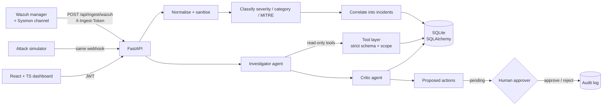

# Aegis SOC — AI-Assisted Security Operations Platform

A working SOC analyst console: it ingests Wazuh/Sysmon security events, correlates them into
incidents, runs **two independent agents** over the evidence (an investigator and a critic), and
requires a human approver before any containment action is recorded.

The design target is a realistic tier-1/tier-2 workflow rather than a chatbot: the AI explains and
prioritises, the analyst decides.

---

## What is actually implemented

| Area | Status |
| --- | --- |
| Wazuh webhook ingestion, normalisation, dedupe | Working (tested) |
| Local Windows Event Log collector (Security/System) | Working; verified against the live System channel; Security-channel reads require elevation |
| Severity/category classification + MITRE mapping | Working (rule-based, tested) |
| Incident correlation by entity + behaviour | Working (tested) |
| Investigator agent (evidence-linked findings) | Working (tested) |
| Critic agent (independent verification) | Working (tested) |
| Read-only tool layer with strict validation | Working (tested) |
| Human approval workflow + audit log | Working (tested) |
| JWT auth, RBAC, scrypt hashing, rate limiting | Working (tested) |
| React/TypeScript dashboard | Working (browser-verified) |
| Docker Compose deployment | Written, **not executed** here (no Docker on the build host) |
| Live LLM narrative (Ollama / OpenAI-compatible) | Implemented and unit-tested with a stub; **not exercised against a live provider** here |
| Wazuh API polling | Not implemented — ingestion is webhook-only |
| Real containment execution | Not implemented by design — approvals are recorded as simulated (dry-run) |

When no LLM provider is reachable, the platform says so in the UI and in every investigation record,
and falls back to a deterministic analysis engine. It never pretends a model produced the summary.

---

## Architecture



Full detail: [docs/architecture.md](docs/architecture.md).

## Technology

- **Backend** — Python 3.13, FastAPI, SQLAlchemy 2 (SQLite by default, any SQLAlchemy URL works),
  PyJWT, httpx, pytest.
- **Agents** — provider-agnostic JSON client: Ollama, OpenAI-compatible endpoints, or deterministic
  analysis. No agent tool can write to the database, run a command or make an arbitrary request.
- **Frontend** — React 19, TypeScript, Vite, Recharts; hand-written dark CSS design system.
- **Deployment** — Docker Compose (API + nginx-served SPA, optional Ollama profile), Wazuh for SIEM,
  Sysmon for Windows telemetry.

## Repository layout

```
backend/
  app/
    api/            HTTP routers: auth, ingest, alerts, incidents, approvals, stats, audit, agents
    agents/         tooling, guardrails, llm client, investigator, critic, orchestrator
    detection/      classification rules and correlation
    ingestion/      Wazuh/Sysmon normalisation
    sim/            five simulated attack scenarios + CLI
    tools/          Windows Event Log collector + elevated launcher
    main.py         app factory, CORS, security headers
  tests/            63 pytest tests
frontend/
  src/pages/        Login, Overview, Alerts, Incidents, IncidentDetail, Approvals, AuditLog
  src/components/   Layout and UI primitives
docs/               architecture, agent design, security model, testing, sample investigations
docker-compose.yml
.env.example
```

---

## Quick start (local)

Prerequisites: Python 3.12+, Node 20+. Ollama is optional.

### 1. Backend

```bash
cd backend
python -m venv .venv
source .venv/Scripts/activate        # Windows bash; use .venv/bin/activate on macOS/Linux
pip install -r requirements.txt

cp ../.env.example .env              # then edit .env (see below)
python -c "import secrets; print(secrets.token_urlsafe(48))"   # SECRET_KEY
python -c "import secrets; print(secrets.token_urlsafe(32))"   # INGEST_TOKEN
```

In `backend/.env` set at minimum:

```ini
SECRET_KEY=<48+ random chars>
INGEST_TOKEN=<random chars>
SEED_DEMO_USERS=true
SEED_ADMIN_PASSWORD=<your admin password>
SEED_ANALYST_PASSWORD=<your analyst password>
SEED_APPROVER_PASSWORD=<your approver password>
SEED_VIEWER_PASSWORD=<your viewer password>
```

Then start the API:

```bash
uvicorn app.main:app --reload --port 8000 --no-proxy-headers
```

Demo accounts are created from the `SEED_*` variables on first start (development only; the seeder
refuses to run when `ENVIRONMENT=production`). Remove `SEED_DEMO_USERS` after creating real accounts.
There is no hard-coded default password anywhere in the codebase.

### 2. Frontend

```bash
cd frontend
npm install
npm run dev          # http://localhost:5173, proxies /api to 127.0.0.1:8000
```

### 3. Generate attacks

```bash
cd backend
python -m app.sim.run                 # ingest 18 events, run both agents on 5 incidents
python -m app.sim.run --no-investigate
python -m app.sim.run --scenario suspicious_powershell
```

The simulator posts through the authenticated webhook, so it exercises the real pipeline
(normalisation → classification → correlation → agents → approval queue).

---

## Connecting Wazuh

Ingestion is a single authenticated webhook:

```
POST /api/ingest/wazuh
X-Ingest-Token: <INGEST_TOKEN>
Content-Type: application/json
```

The body may be one alert, an array, or `{"alerts": [...]}` (max 500 per request). Wazuh's
`integratord` can deliver alerts with a small custom integration script, e.g.
`/var/ossec/integrations/custom-aegis`:

```python
#!/usr/bin/env python3
import json, sys, urllib.request

alert_file, api_key, hook_url = sys.argv[1], sys.argv[2], sys.argv[3]
with open(alert_file, encoding="utf-8") as handle:
    payload = handle.read().encode()

request = urllib.request.Request(
    hook_url,
    data=payload,
    headers={"Content-Type": "application/json", "X-Ingest-Token": api_key},
    method="POST",
)
urllib.request.urlopen(request, timeout=10)
```

`/var/ossec/etc/ossec.conf` on the manager:

```xml
<integration>
  <name>custom-aegis</name>
  <hook_url>http://aegis-host:8000/api/ingest/wazuh</hook_url>
  <api_key>YOUR_INGEST_TOKEN</api_key>
  <level>3</level>
  <alert_format>json</alert_format>
</integration>
```

Restrict the source with `INGEST_ALLOWED_IPS` (comma-separated) and keep the webhook behind TLS in
any real deployment. Leave `TRUST_PROXY_HEADERS=false` unless a proxy you control overwrites
`X-Forwarded-For`, and start uvicorn with `--no-proxy-headers` so it does not trust the header itself.

### Sysmon telemetry

Sysmon events reach the platform through Wazuh (no separate agent needed). On the Windows endpoint:

```xml
<localfile>
  <log_format>eventchannel</log_format>
  <location>Microsoft-Windows-Sysmon/Operational</location>
</localfile>
```

Normalisation reads `data.win.eventdata.commandLine`, `targetUserName`, `ipAddress`, and
`data.win.system.computer`, so Sysmon 4104 (script block) and 4688 (process creation) events land in
the PowerShell / network / privilege categories.

### Reading this machine's logs without Wazuh

The collector in `backend/tools/windows_event_collector.py` ships real Windows Event Log records to
the same webhook, so the dashboard shows actual activity instead of only simulated data. It uses
PowerShell `Get-WinEvent`; no extra Python packages are needed.

```powershell
cd backend
tools\collect-security.cmd          # UAC prompt; reads Security for the last 24h, then polls every 20s
```

Or run it yourself (elevated for Security):

```bash
cd backend
.venv/Scripts/python tools/windows_event_collector.py --channel Security --since-minutes 1440 --interval 20
.venv/Scripts/python tools/windows_event_collector.py --once --channel System --event-ids 7036 --dry-run
```

Mapped Security events: 4625 failed logon, 4624 successful logon, 4672 special privileges, 4688
process creation (PowerShell commands become high severity), 4720 account created, 4728/4732/4756
privileged group changes, 1102 audit log cleared. System-channel service installs (7045) are mapped
too, so `--channel System` works without elevation.

- Security-channel events **require elevation** (or membership in `Event Log Readers`); the wrapper
  prompts for it. Nothing is written to the Security log.
- The checkpoint lives in `backend/data/windows_collector_state.json`; alert IDs derive from the
  channel and Windows record ID, so replayed events are deduplicated by the API.
- Search the dashboard for `4625` to find the failed sign-ins; they correlate into a brute-force
  incident per host.
- Existing simulated/demo alerts stay in the database until you clear it; the collector only adds
  real events.
- If no 4625 events appear after elevating, failure auditing may be off for this machine:
  `auditpol /set /subcategory:"Logon" /failure:enable` (admin), then reproduce the failed sign-in.

---

## Configuring the LLM

| Variable | Purpose |
| --- | --- |
| `LLM_PROVIDER` | `auto` (default), `ollama`, `openai`, `none` |
| `OLLAMA_BASE_URL` / `OLLAMA_MODEL` | e.g. `http://localhost:11434`, `llama3.1` |
| `OPENAI_BASE_URL` / `OPENAI_MODEL` / `OPENAI_API_KEY` | any OpenAI-compatible endpoint |
| `LLM_TIMEOUT_SECONDS` | request timeout (default 45) |

`auto` order: Ollama if reachable → OpenAI-compatible if a key is set → deterministic analysis.
Check what is active at any time with `GET /api/agents/status` or the sidebar badge.

Local example:

```bash
ollama pull llama3.1
ollama serve
# .env: LLM_PROVIDER=ollama
```

Model replies are rejected unless they match a strict JSON schema and cite alert IDs that belong to
the incident; rejected replies are recorded on the investigation and the deterministic findings stay.

---

## Roles

| Role | Read | Run investigation | Propose action | Approve / reject | Audit log |
| --- | --- | --- | --- | --- | --- |
| `viewer` | ✅ | ❌ | ❌ | ❌ | ❌ |
| `analyst` | ✅ | ✅ | ✅ | ❌ | ❌ |
| `approver` | ✅ | ❌ | ❌ | ✅ | ❌ |
| `admin` | ✅ | ✅ | ✅ | ✅ | ✅ |

Enforced server-side in `app/security.py::require_roles`; the UI hides controls it cannot use, but
authorisation never depends on the UI.

## API

| Method | Path | Purpose |
| --- | --- | --- |
| `POST` | `/api/auth/login` | JWT login (rate limited) |
| `GET` | `/api/auth/me` | Current user |
| `POST` | `/api/ingest/wazuh` | Wazuh webhook (token auth) |
| `GET` | `/api/alerts` | Filter/search alerts (`q`, `severity`, `category`, `status`, `limit`, `offset`) |
| `GET` | `/api/alerts/{id}` | Alert detail |
| `GET` | `/api/incidents` | Incident queue |
| `GET` | `/api/incidents/{id}` | Incident + alerts + investigations + actions |
| `POST` | `/api/incidents/{id}/investigate` | Run investigator + critic |
| `PATCH` | `/api/incidents/{id}/status` | Change workflow status |
| `POST` | `/api/incidents/{id}/actions` | Analyst-proposed action |
| `GET` | `/api/approvals` | Pending approvals |
| `POST` | `/api/approvals/{id}/decision` | Approve / reject (approver, admin) |
| `GET` | `/api/stats/overview` | Dashboard aggregates |
| `GET` | `/api/audit` | Audit trail (admin) |
| `GET` | `/api/agents/status` | LLM provider status |
| `GET` | `/api/agents/tools` | Read-only tool catalogue (admin) |
| `GET` | `/api/health` | Liveness + LLM mode |

Interactive docs: `http://localhost:8000/api/docs`.

---

## Testing

```bash
cd backend && .venv/Scripts/python -m pytest -q     # 63 tests
cd frontend && npm run build                        # typecheck + production build
```

The suite covers ingestion and dedupe, classification, correlation, agent tool permissions and
argument validation, prompt-injection redaction, LLM output validation (including fabricated alert
IDs), critic verification, auth/RBAC, rate limiting, CORS, audit logging and the approval workflow.
See [docs/testing.md](docs/testing.md).

## Deployment

```bash
cp .env.example .env    # set SECRET_KEY, INGEST_TOKEN, demo accounts off for production
docker compose up --build
# dashboard http://localhost:5173, API http://localhost:8000
```

Optional local model: `docker compose --profile llm up --build` (set `OLLAMA_BASE_URL=http://ollama:11434`).
Compose runs the API as a non-root user with a read-only filesystem (SQLite data lives in a volume),
and nginx adds CSP/security headers.

## Security notes and limitations

- Agents are read-only: no shell, no arbitrary HTTP, no database writes, no approval rights.
- Logs and event text are untrusted: control characters are stripped, instruction-like phrases are
  redacted, and the evidence bundle is wrapped in `<untrusted>` tags before it reaches the model.
  Attacks on the model are recorded and never change agent permissions.
- Approved actions are recorded as **simulated (dry-run)** containment. Nothing is blocked, isolated
  or disabled. Real execution would need an integration adapter plus a change-management policy.
- SQLite is fine for a lab; move to PostgreSQL by changing `DATABASE_URL` (SQLAlchemy-compatible).
- Investigations run synchronously inside the request; production would use a task queue.
- Full threat model and production checklist: [docs/security-model.md](docs/security-model.md).

## Documentation

- [docs/architecture.md](docs/architecture.md) — components, data flow, data model, correlation rules
- [docs/agent-design.md](docs/agent-design.md) — both agents, tool contracts, prompt-injection defences
- [docs/security-model.md](docs/security-model.md) — threat model, controls, limitations
- [docs/testing.md](docs/testing.md) — how to test, what is covered, simulator scenarios
- [docs/security-audit.md](docs/security-audit.md) — independent audit findings, fixes and residual risk
- [docs/acceptance-test-report.md](docs/acceptance-test-report.md) — independent acceptance run: features, API/RBAC/security checks, detection accuracy, screenshots
- [docs/sample-investigations.md](docs/sample-investigations.md) — real output from the simulator
