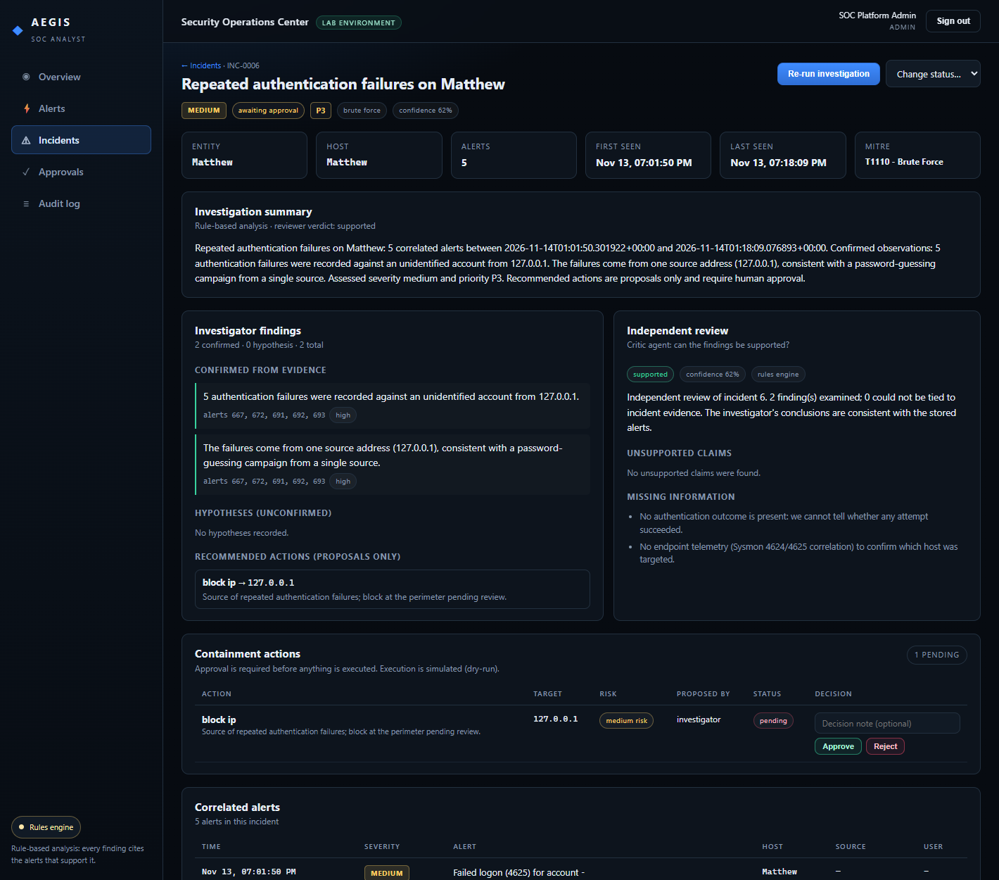

# Aegis SOC

A small security operations dashboard I built myself to learn how a SIEM and a SOC really work.

I'm early in my cybersecurity career and I noticed that the enterprise tools that are used are not
taught. School is more of a textbook definition of cybersecurity whereas I wanted to jump in and do
something hands on to learn and practice.

## What it does

- Takes in security alerts from my own Windows event logs.
- Cleans them up and labels each one with a category, a severity and a MITRE ATT&CK technique.
- Groups related alerts into a single incident. Eight failed logins against one machine is one
  brute-force attempt, not eight separate things to look at.
- Runs two small agents over an incident. One writes up what happened and cites the alert IDs it
  used; the other checks that write-up and can disagree with it.
- Puts any suggested response in front of a human. Approving something records the decision.
- Keeps an audit log of who did what.

## What it looks like

*The overview page.*

*An incident, with the investigation, the second agent's opinion and the actions waiting for approval.*

## What it's built with

Python and FastAPI on the backend, SQLite for storage, React and TypeScript on the frontend. The
analysis is 100% rule-based which means that every decision has an explanation.

## About this project

This is a personal learning project, not a product. It has never been run against a live Wazuh
manager and it never acts on a real network. I built it to understand how tools like this are used in
the professional cybersecurity world.
