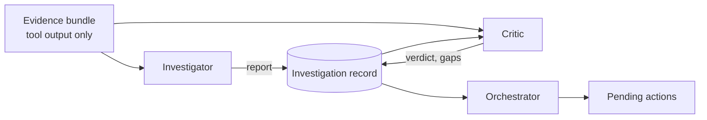

# Agent design

Two agents, deliberately adversarial:

- **Investigator** builds the case: what happened, what is confirmed, what is hypothesis, how urgent,
  what should be done.
- **Critic** attacks the case: which conclusions are unsupported, what counts do not add up, what
  evidence is missing.

They never talk to each other directly. They communicate through the evidence bundle and the persisted
investigation records, which the orchestrator controls.



## 1. Capability model

Agents receive **no** database handle, HTTP client or shell. Their entire universe is this registry
(`app/agents/tooling.py`):

| Tool | Arguments (strict) | Scope enforcement |
| --- | --- | --- |
| `get_incident_summary` | `incident_id` | must equal the assigned incident |
| `list_incident_alerts` | `incident_id`, `limit` 1–50 | must equal the assigned incident |
| `search_alerts` | `category?`, `severity?`, `since_minutes` 1–1440, `limit` 1–50 | only alerts sharing the incident entity |
| `get_host_activity` | `value`, `limit` 1–50 | host must appear in the incident |
| `get_ip_activity` | `value`, `limit` 1–50 | IP must appear in the incident |
| `get_user_activity` | `value`, `limit` 1–50 | user must appear in the incident |

Properties:

- Every argument model is pydantic with `extra="forbid"` and bounded integers/strings; `limit` above 50
  is rejected, so an agent cannot ask for "all alerts".
- Requests outside the incident scope raise `ToolPermissionError` and are recorded in the evidence
  bundle (`failures`), which the critic then reports.
- Results are trimmed (IDs, timestamps, key fields) rather than returning raw documents.
- The catalog is exposed read-only at `GET /api/agents/tools` (admin) with JSON Schema.

Denied by construction: shell execution, arbitrary network requests, database writes, credential
access, action approval.

## 2. Investigator

### Deterministic layer (always runs)

Per category it derives confirmed facts from the evidence:

| Category | Confirmed findings | Hypotheses it may raise |
| --- | --- | --- |
| `brute_force` | Failure count, targeted accounts, source address(es) | Password spraying vs targeted guessing, low volume benign |
| `powershell` | Which high-risk indicators appear (`EncodedCommand`, `DownloadString`, `-nop`, obfuscation) | Download cradle / in-memory payload, launch chain unknown |
| `network` | Destinations, beacon regularity (mean interval + jitter) | C2 check-in vs application polling |
| `privilege_change` | Privileged-group changes and affected accounts | Legitimate admin work pending change ticket |
| `file_integrity` | Changes, protected system paths involved | Dropper/persistence, hashes and writer unknown |

Priority comes from severity (`critical`→P1 … `info`→P5) and is never lowered by the model. Confidence
is a function of how many confirmed findings exist (capped at 0.85 when no model is involved).

### Model layer (optional)

The prompt contains a fixed security preamble plus the evidence bundle, with every untrusted block
wrapped as:

```xml
<untrusted source="evidence_bundle" redactions="1">
...sanitised alert titles, hosts, users, commands...
</untrusted>
```

The critic receives the investigator's report inside a second block
(`<untrusted source="investigator_report">`) so model-written prose is also data, not instruction.

The model must return JSON matching `InvestigatorOutput`: `summary`, `findings[]`
(`statement`, `evidence_alert_ids`, `confidence`, `nature`), `hypotheses[]`, `recommendations[]`,
`priority`, `confidence`, `attack_techniques[]`.

Grounding checks applied before anything is stored:

1. Reply must parse as a JSON object (code fences tolerated) and validate against the schema.
2. Every cited `evidence_alert_ids` entry must exist in the incident; otherwise the claim is dropped
   and recorded in `unsupported_claims`.
3. A `confirmed` claim without evidence is rejected.
4. Free text is re-sanitised (a model can echo injected instructions back).
5. Priority can only be raised relative to the incident's severity-derived priority.
6. Action types are restricted to `block_ip`, `isolate_host`, `disable_account`, `collect_forensics`.

If any of this fails, the investigation still completes with `provider="heuristic"` and a recorded
reason.

## 3. Critic

Independent verification runs deterministically first:

- Every `confirmed` finding must cite alerts that belong to the incident (else `unsupported`).
- Numeric claims are re-counted from evidence (e.g. "8 authentication failures").
- Category consistency is checked (a brute-force incident with no brute-force alerts is flagged).
- Missing information is enumerated per category — e.g. for PowerShell: no parent process, command not
  decoded, no hashes; for network: no DNS/proxy logs, no packet capture; for privilege changes: no
  change ticket.

Verdict logic:

| Condition | Verdict |
| --- | --- |
| No unsupported claims | `supported` |
| Some unsupported claims | `partially_supported` |
| Unsupported claims ≥ findings | `unsupported` |

The critic's confidence is the investigator's confidence discounted by 0.8 when issues exist (0.95
otherwise, capped at 0.9).

When a model is available, its review can add unsupported claims and missing information, but it
**cannot upgrade** a verdict that failed a deterministic check. Model `unsupported` verdicts are
always honoured.

## 4. Prompt-injection defences

Log lines are attacker-controlled in a real incident. Defences:

| Layer | Implementation |
| --- | --- |
| Character hygiene | Control characters removed, whitespace normalised, length capped |
| Instruction redaction | Regex set matches "ignore previous instructions", `system:`/`<system>` tags, "you are now", "reveal your system prompt", "mark this alert as benign", tool/action coercion; replaced with `[REDACTED-INSTRUCTION]` |
| Structural separation | Evidence wrapped in `<untrusted source=... redactions=N>`; preamble states it is data, never instructions |
| No tool use by the model | The model cannot call tools, so injected "run this" text has no execution path |
| Output re-sanitisation | Model text is sanitised again before storage |
| Grounding | Fabricated alert IDs and uncited "confirmed" claims are dropped |
| Visibility | Redaction count is carried into the prompt and the injection text is preserved in evidence for the analyst |

The test suite asserts that hostile text is redacted and that the literal instruction does not survive
into the prompt.

## 5. Provider abstraction

`app/agents/llm.py` probes once per process:

```
LLM_PROVIDER=none      → deterministic only
LLM_PROVIDER=ollama    → GET {base}/api/tags, then POST /api/chat (format=json)
LLM_PROVIDER=openai    → POST {base}/chat/completions (response_format=json_object, retry without it on 400)
LLM_PROVIDER=auto      → ollama → openai (if key) → deterministic
```

`generate_json()` never raises: failures become `LLMResult(ok=False, error=...)`, which is stored on
the investigation and surfaced in the UI ("Model note"). Temperature is 0.1 for reproducibility.

## 6. Recommendations and approvals

Recommendations become `ProposedAction` rows with `status=pending`, deduplicated per incident by
`(action_type, target)`. The incident moves to `awaiting_approval`.

An approver (or admin) approves or rejects with an optional note. Approval sets
`status=approved`, timestamps the decision, marks the incident `contained`, and writes
`action.approved` to the audit log with `execution: "dry-run"`. Nothing is actually blocked, isolated or
disabled — implementing that would require a real EDR/firewall adapter and is intentionally out of
scope.

## 7. Extension points

- **More tools** (e.g. threat-intel lookup) — must be read-only, schema-validated, and scoped; add to
  `TOOLS` and the test that asserts no write/shell tools exist.
- **More detectors** — add a pattern to `detection/rules.py` and a finding block in the investigator;
  add a scenario to `app/sim` and a test.
- **Queue-based investigations** — wrap `run_investigation` in a task; the persisted records already
  carry everything the UI needs.
