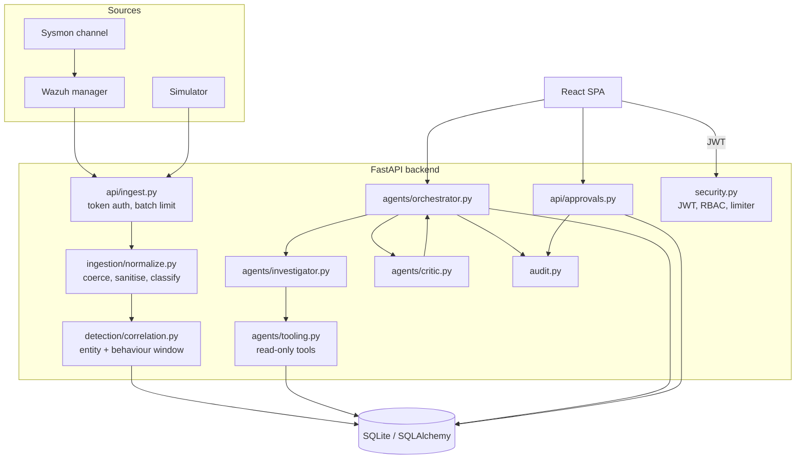
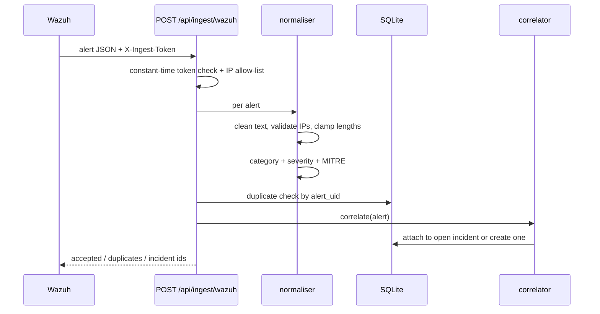
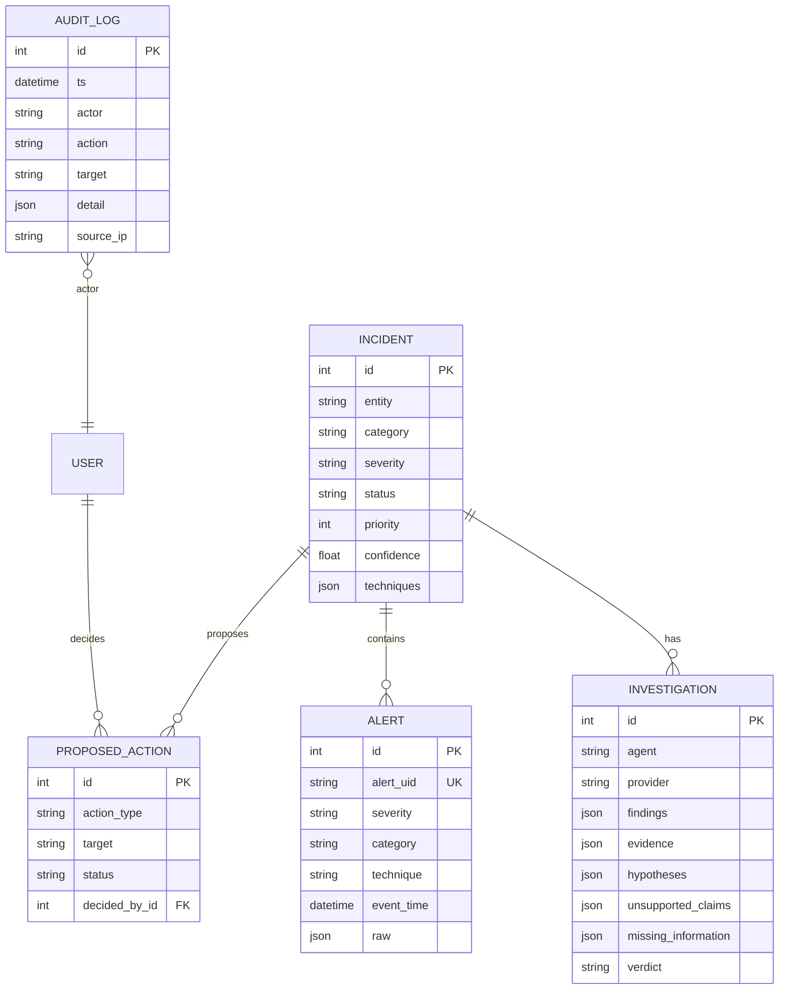
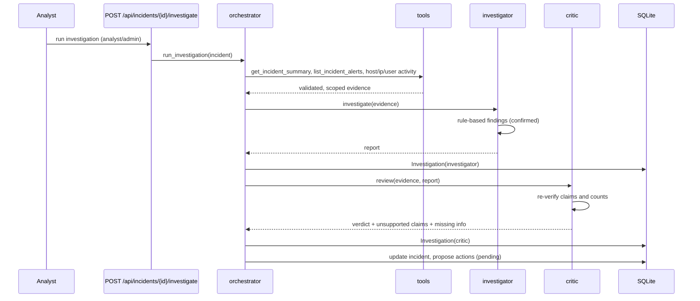

# Architecture

## 1. Design goals

1. **Deterministic before generative.** Severity, category, correlation and every "confirmed" finding
   are computed by rule-based code. A language model may add narrative and hypotheses, never facts.
2. **Read-only agents.** Agents reach data only through a small, schema-validated tool registry. There
   is no shell tool, HTTP tool or write tool to abuse.
3. **Human approval for anything destructive.** Agents propose; an approver decides; the decision is
   audited and executed as a recorded dry-run.
4. **Untrusted by default.** Log lines, descriptions, hostnames and usernames are hostile input and are
   sanitised before storage and before any prompt.

## 2. Components

| Module | Responsibility |
| --- | --- |
| `app/api/ingest.py` | Authenticates the webhook, enforces batch limits, deduplicates, stores alerts |
| `app/ingestion/normalize.py` | Maps Wazuh/Sysmon JSON to the internal alert shape, strips control characters, validates IPs, clamps lengths |
| `app/detection/rules.py` | Severity from Wazuh rule level, behaviour classification, MITRE hint |
| `app/detection/correlation.py` | Groups alerts into incidents per entity + category inside a 90-minute window |
| `app/agents/tooling.py` | The only data access path for agents: 6 read-only tools, strict pydantic args, incident-scoped |
| `app/agents/evidence.py` | Calls the tools and builds the evidence bundle used by both agents |
| `app/agents/investigator.py` | Rule-based findings, each citing the alerts that support it |
| `app/agents/critic.py` | Independently re-derives facts, checks claims, enumerates missing information |
| `app/agents/orchestrator.py` | Runs both agents, persists reports, updates the incident, proposes actions |
| `app/api/approvals.py` | Approver-only decision endpoint, dry-run execution record |
| `app/audit.py` | Append-only audit entries for auth, ingestion, investigation, approval |

## 3. Ingestion and normalisation

Key defensive details:

- Maximum 500 alerts per request; arrays, single objects and `{"alerts": [...]}` are accepted.
- `alert_uid` is the Wazuh alert id, or a SHA-256 fingerprint of the document, so replays are deduped.
- IP fields are parsed with `ipaddress.ip_address`; invalid values become `null` instead of polluting
  the database or the prompt.
- Text is stripped of control characters, whitespace-normalised and length-limited (title 300,
  description 4000).

## 4. Classification

Severity comes from the Wazuh rule level (`>=12 critical`, `>=10 high`, `>=7 medium`, `>=4 low`), with a
floor applied to high-risk behaviours (PowerShell/privilege changes never land below `medium`).

Category is matched in priority order over title + description + rule id + Wazuh groups:

| Category | Example evidence | MITRE hint |
| --- | --- | --- |
| `powershell` | `-EncodedCommand`, `DownloadString`, `IEX`, 4104 | T1059.001 |
| `privilege_change` | "user added to administrators", 4720/4728, `usermod -aG sudo` | T1098 |
| `file_integrity` | syscheck 550/554, startup folder, autorun | T1565.001 |
| `brute_force` | "logon failure", 4625, repeated auth failures | T1110 |
| `network` | outbound connection, C2, beaconing, 5156 | T1071 |
| `other` | anything unrecognised | T1000 |

## 5. Correlation

An incident is keyed on **entity** (host, else source IP, else username) and **category**, and absorbs
new alerts while it is `open`/`investigating`/`awaiting_approval` and its last activity is within 90
minutes. Absorbing an alert escalates severity to the highest seen, unions MITRE techniques, updates the
window and increments the alert count. A different behaviour on the same host becomes a separate
incident, which keeps investigations focused.

## 6. Data model

All timestamps are stored as UTC (`UTCDateTime` type decorator) and returned timezone-aware.

## 7. Investigation flow

## 8. Failure behaviour

| Failure | Behaviour |
| --- | --- |
| A finding cites alert IDs outside the incident | Claim dropped; the critic records it as unsupported |
| The incident has no usable evidence | Low-confidence findings; the critic lists the missing telemetry |
| Tool args invalid or out of scope | Tool raises, evidence records the rejected call, critic reports it |
| Approver decides twice | `409 Conflict` |
| Webhook token invalid | `401`, nothing stored |

## 9. Scaling path

- Replace SQLite with PostgreSQL (`DATABASE_URL`), keep SQLAlchemy models.
- Move investigation to a worker queue; return `202` and stream status via polling/SSE.
- Poll the Wazuh indexer API for environments that cannot push webhooks.
- Add per-tenant row scoping if used by more than one SOC.
